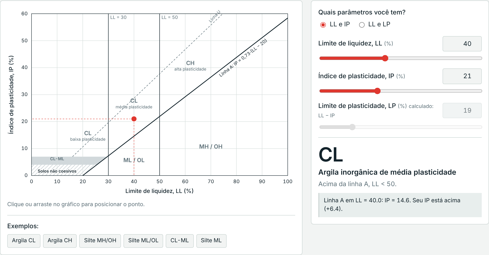
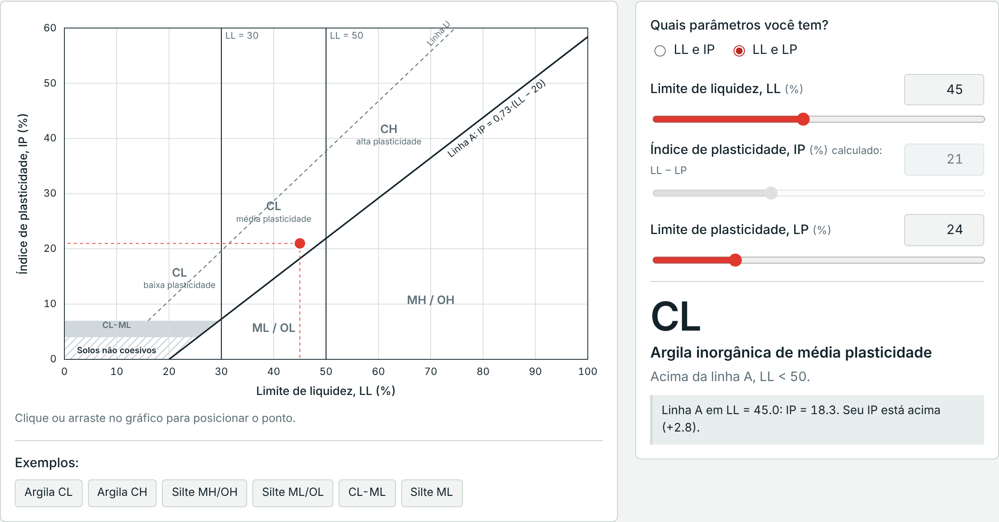
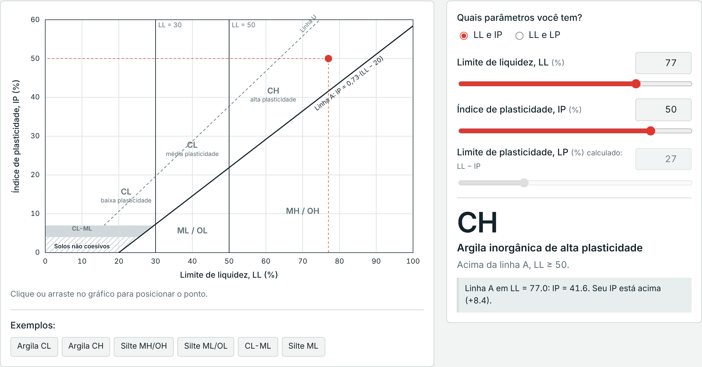
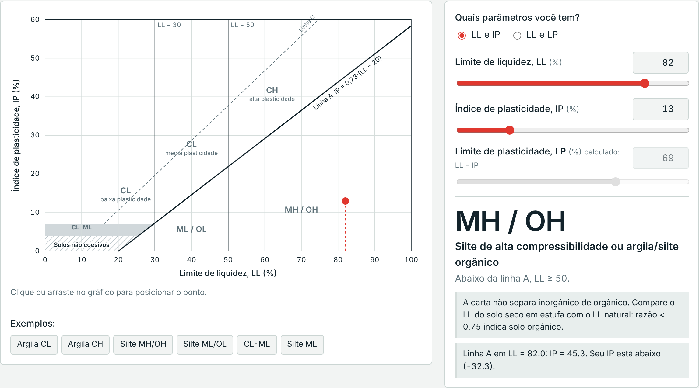
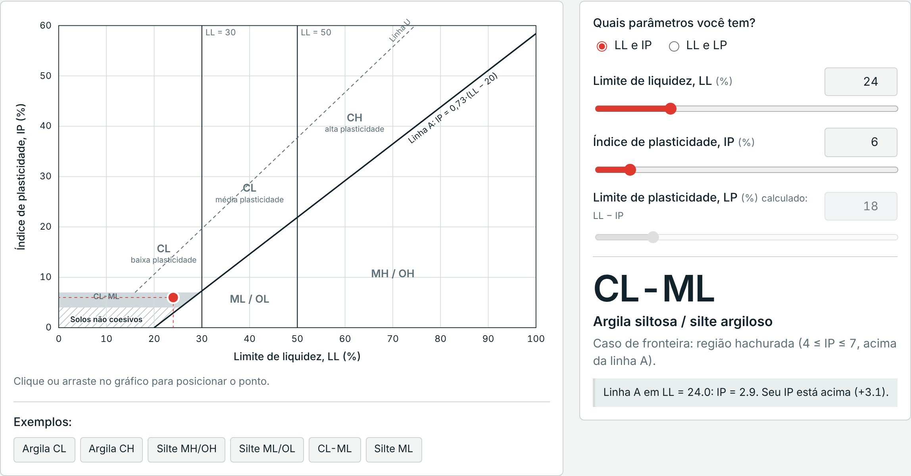
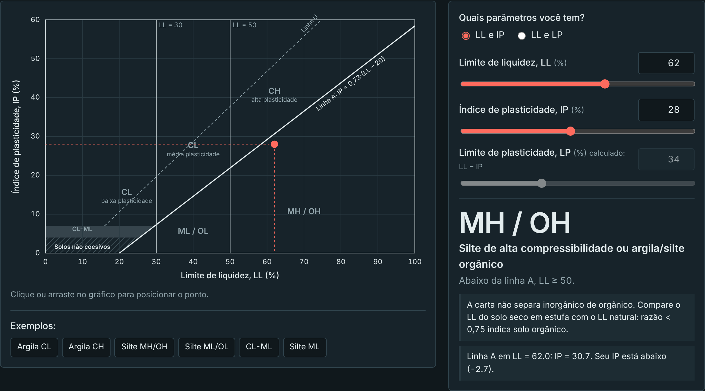
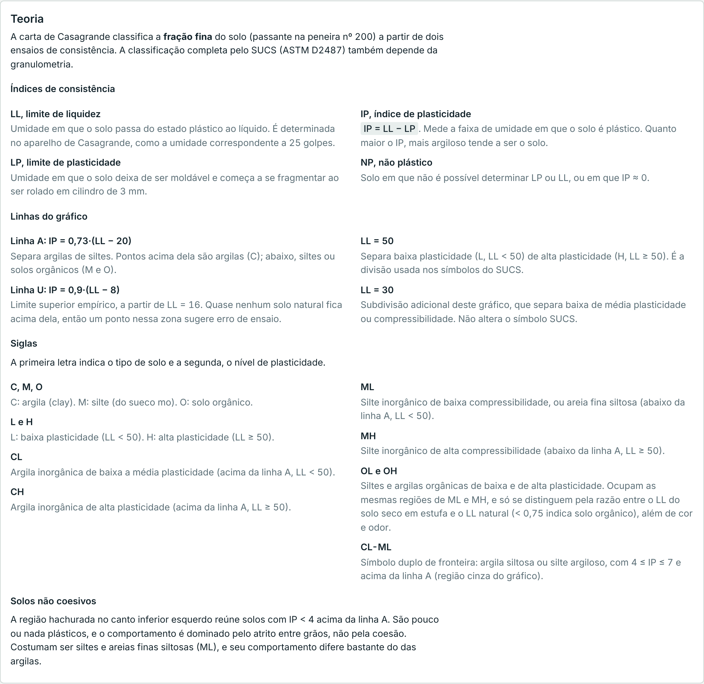
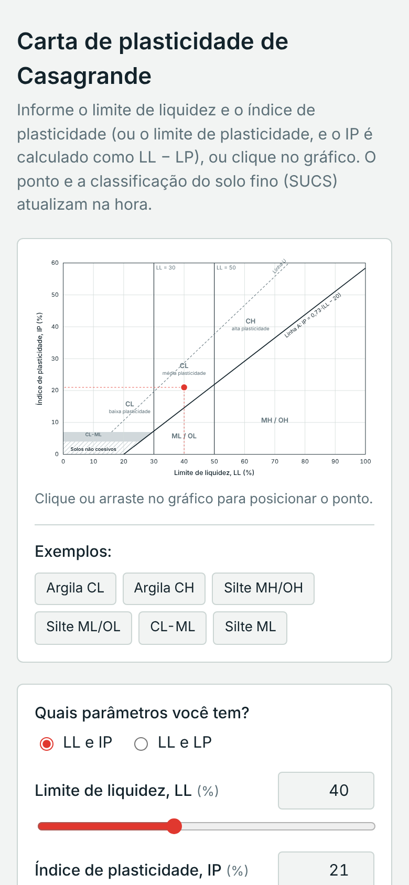

# Carta de Plasticidade de Casagrande

Ferramenta de geotecnia para **classificar solos finos pelo SUCS** (ASTM D2487). Informe o limite de liquidez (LL) e o índice de plasticidade (IP), ou o limite de plasticidade (LP), e veja o ponto na carta com a classificação na hora.

É um único arquivo HTML: abra com duplo clique no navegador, sem instalar nada e sem internet.

**Demonstração online:** https://victortlacerda.github.io/classifica-o-solos-carta-de-plasticidade-casagrande/



## Por que usar

- **Classificação imediata.** O ponto é plotado e o símbolo SUCS aparece conforme você digita, sem consultar a carta no papel.
- **Menos erro de ensaio.** A página avisa quando IP > LL, quando o LP é maior que o LL e quando o ponto fica acima da linha U.
- **Serve para estudo e para campo.** Traz a teoria completa abaixo do gráfico e funciona no celular.

## Como funciona

### Informe LL e IP, ou LL e LP

Escolha quais parâmetros você tem. No modo **LL e LP**, o IP é calculado como LL − LP e usado na classificação. Também dá para clicar ou arrastar direto no gráfico.



### Todas as regiões da carta

<table>
<tr>
<td width="50%"><br><sub><b>CH</b>: argila inorgânica de alta plasticidade</sub></td>
<td width="50%"><br><sub><b>MH / OH</b>: silte de alta compressibilidade ou solo orgânico</sub></td>
</tr>
<tr>
<td width="50%"><br><sub><b>CL-ML</b>: caso de fronteira, com 4 ≤ IP ≤ 7</sub></td>
<td width="50%"><br><sub>Tema escuro automático</sub></td>
</tr>
</table>

### Teoria integrada

A página explica os índices de consistência, as linhas A e U, as divisões em LL = 30 e LL = 50, cada sigla (C, M, O, L, H, CL, CH, ML, MH, OL, OH, CL-ML) e a região de solos não coesivos.



### No celular



## Recursos

- Ponto plotado na carta em tempo real, com guias até os eixos
- Entrada por **LL e IP** ou por **LL e LP**
- Clique ou arraste no gráfico para posicionar o ponto
- Classificação: CL, CH, ML/OL, MH/OH e CL-ML, com descrição
- Linha A (IP = 0,73·(LL − 20)), linha U (IP = 0,9·(LL − 8)), LL = 30 e LL = 50
- Região de solos não coesivos (IP < 4)
- Avisos de dados inconsistentes
- Exemplos prontos
- Tema claro e escuro automático
- Funciona offline, sem dependências nem etapa de build

## Lógica de classificação

| Posição na carta | Símbolo |
|---|---|
| Acima da linha A, 4 ≤ IP ≤ 7 | CL-ML |
| Acima da linha A, IP ≥ 4, LL < 50 | CL |
| Acima da linha A, IP ≥ 4, LL ≥ 50 | CH |
| Acima da linha A, IP < 4 (não coesivo) | ML |
| Abaixo da linha A, LL < 50 | ML (ou OL) |
| Abaixo da linha A, LL ≥ 50 | MH (ou OH) |

A carta não separa solos inorgânicos de orgânicos. Para isso, use a razão entre o LL do solo seco em estufa e o LL natural (< 0,75 indica solo orgânico). A classificação completa pelo SUCS também exige a granulometria, e a carta classifica apenas a fração fina.

## Como usar

Abra o `index.html` no navegador. Não há nada para instalar.

## Publicar no GitHub Pages

Em **Settings → Pages → Build and deployment**, escolha **GitHub Actions**. O workflow em `.github/workflows/pages.yml` publica a página a cada push na branch `main`.

## Atualizar os prints

Os prints ficam em `docs/screenshots/`. Depois de mudar a interface, gere-os de novo e faça o commit junto com a alteração.

## Fluxo de atualização

```bash
git add -A
git commit -m "feat: descrição da mudança"
git push
```

Prefixos de commit sugeridos: `feat`, `fix`, `docs`, `style`, `refactor`, `chore`.
